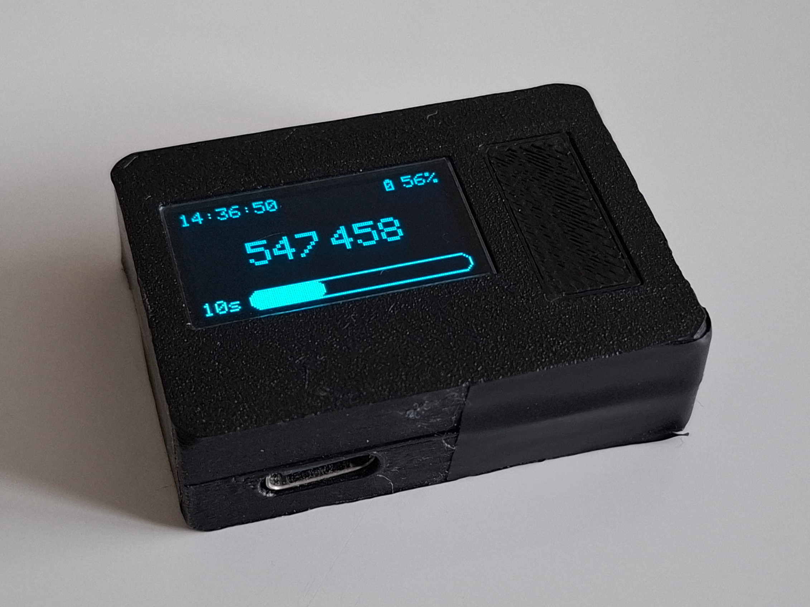

# ESP32-S3 based TOTP code generator
A pocket TOTP code generator running on the [SeeedStudio Xiao ESP32-S3](https://wiki.seeedstudio.com/xiao_esp32s3_getting_started/) board.

## Assembly of the device
Located at [assembly.md](assembly.md)

## Building and flashing
Building and flashing is done using [VSCode](https://code.visualstudio.com/) and the [PlatformIO](https://platformio.org/) extension. Simply open the project's root directory in Visual Studio Code with the PlatformIO extension installed. The PlatformIO extension automatically takes care of installing and configuring the dependencies.

### Dependencies:
(dependencies are automatically installed by the PlatformIO extension)
- [Adafruit RTClib](https://github.com/adafruit/RTClib) v2.1.4
- [Adafruit SSD1306](https://github.com/adafruit/Adafruit_SSD1306) v2.5.16
- [Arduino-Base32-Decode](https://github.com/dirkx/Arduino-Base32-Decode.git) v1.01
- [TOTP-Arduino](https://github.com/lucadentella/TOTP-Arduino) v1.1.0

## Before first use

Open the [configuration.h](include/configuration.h) file.

- Modify the "secret" variable to match your TOTP secret you obtained while setting up multi-factor authentication.
- Set your WiFi credentials under the "WiFi configuration".
- Set your time zone under the "NTP configuration". Use the [POSIX format](https://github.com/nayarsystems/posix_tz_db/blob/master/zones.csv)!

## Further optional configuration

All configurable values can be found in the [configuration.h](include/configuration.h) file.

Language of the displayed information can be changed by including the corresponding [infotext header file](include/infotexts/) in [main.cpp](src/main.cpp).

## Using the device
The device is controlled using a button. 

By default configuration, holding the button for: 
- 1 second - turns on the main screen
- 7 seconds - synchronizes the time with an NTP server

After 7 seconds of inactivity (released button), the device turns off the screen and goes to sleep.

## Secure data storage
It is recommended to enable **flash encryption** to prevent an attacker from gaining access to your TOTP secret, if they gained physical access to your generator.

Beware, enabling flash encryption in release mode is an **irreversible** process! Using an internally generated encryption key normally makes it **impossible** to flash a different program on the device without soft-bricking it!
Enable the flash encryption only after you completely understand it's implications.

Follow the [ESP32-S3 Flash Encryption documentation](https://docs.espressif.com/projects/esp-idf/en/stable/esp32s3/security/flash-encryption.html), if you want to use this feature.

## Showcase

