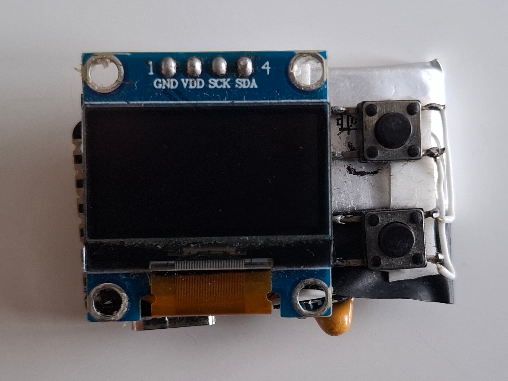
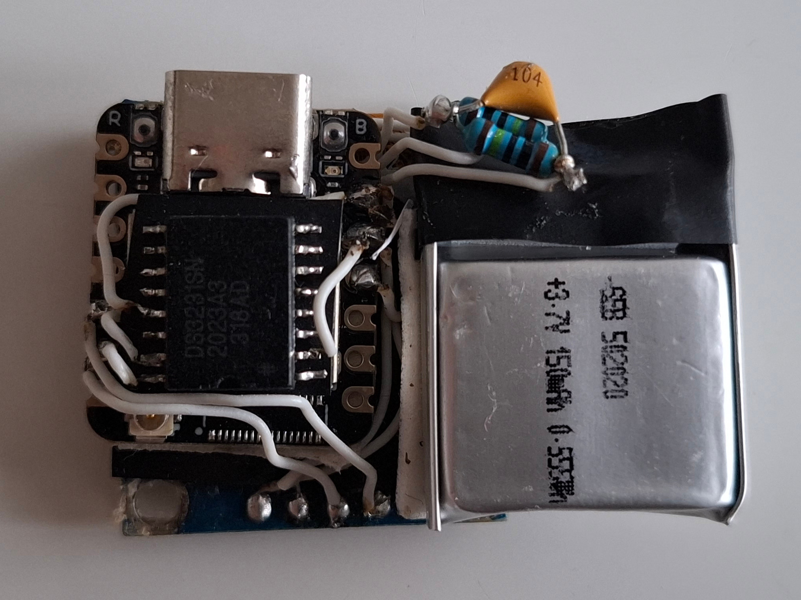
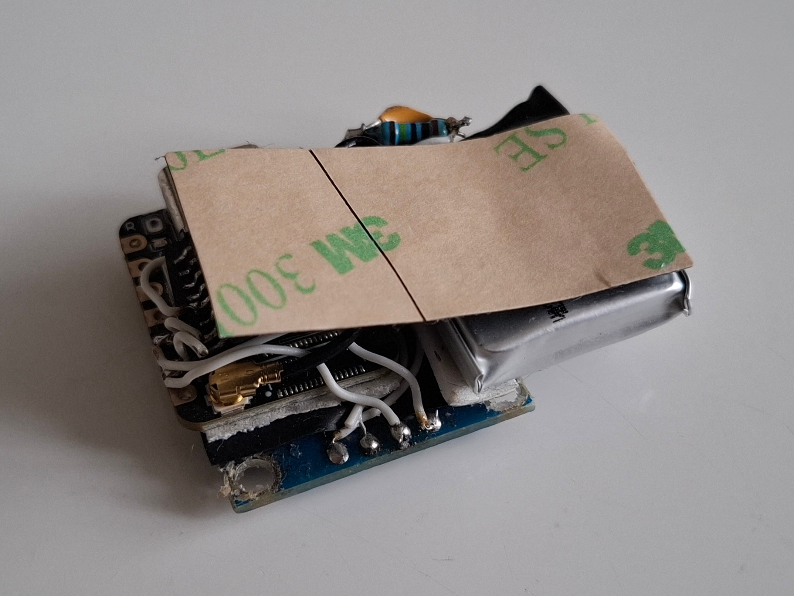

# Assembly of the device

## Parts list
- Seeed Studio XIAO ESP32-S3
- Flat 2,4GHz antenna with U.FL connector (normally shipped together with the XIAO ESP32-S3)
- I2C OLED display 0,96" 128x64 SSD1306
- DS3231 chip
- LiPol battery 150mAh/3.7V (LP502020; 20×22×4,5mm)
- 2x 1MΩ resistor
- 100nF capacitor
- 2x Pushbutton (6x6x4,3mm)

## Wiring diagram

## Assembled parts

### Front view

### Back view without antenna

### Back view with antenna

## Cover
3D models will be added shortly
